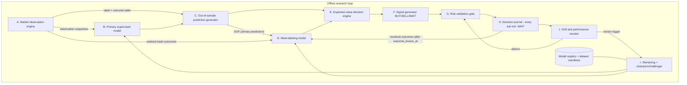

# AIBOT Agent Architecture (proposed)

Status: design only (Phase 0). Nothing here is implemented.
Scope: a research agent that observes closed XAUUSD bars, learns from realized historical trade outcomes and emits BUY / SELL / WAIT **signal records**.
Explicit exclusions: no order execution, no broker trading calls, no live position management. The only MT5 use is the read-only history download (`copy_rates_range`), ending at the last closed bar.

## 1. Design principles

1. **One clock.** Every artifact stores the server-time bar timestamp *and* UTC, using Europe/Athens → UTC as established in experiment E10. The **decision time** τ of bar t is the bar's close: open + 5 minutes for M5.
2. **As-of semantics.** Every value carries the time it became knowable (`available_at`). A component may use a value only if `available_at ≤ τ`.
3. **Closed bars only.** Higher-timeframe values come from the most recent *completed* candle (the rule already enforced in E8 and E15).
4. **Outcomes are delayed facts.** A trade outcome for decision τ becomes knowable only at `outcome_known_at` = the exit bar's close (≤ τ + 12 bars for the current label). Nothing may learn from an outcome before that time.
5. **WAIT is the default.** A BUY or SELL needs every stage to pass; any failure, missing value or alarm yields WAIT with a reason code.
6. **Reuse, don't replace.** The existing `features_m5.py`, `label_m5.py`, `split_m5.py`, `backtest_rf_m5.py` and the guards in `research_kronos_m5.py` stay unchanged. New components wrap or import them in new files.
7. **Holdout isolation.** Nothing after 2026-09-29 18:50 is read until the single pre-registered holdout evaluation (ACCEPTANCE_CRITERIA.md, gate G4).

## 2. Data flow

## 3. Components

### A. Market observation engine

| | |
|---|---|
| Purpose | Turn raw MT5 history into validated, causal, time-stamped observations. |
| Inputs | `xauusd_m5.csv` (row-capped), `xauusd_h1_mt5.csv`, and future append-only downloads of closed bars. |
| Reuses | `features_m5.load_and_validate`, `features_m5.build_features`, the M15/H1 aggregation from E14/E15, the clock conversion from E10/E15. |
| Outputs | (1) `observations_<tf>.parquet/csv`: one row per closed bar, with `time_server`, `time_utc`, `tau_utc`, features, `data_version`. (2) `outcomes_m5.csv`: per row and per side, the outcome (TP, SL or TIME), exit bar, `net_r`, `outcome_known_at`. This is a *new* file. Existing labels are not changed. (3) `dataset_manifest.json`: source, row count, first and last bar, prefix hashes. |
| Leakage controls | Truncation-invariance test: features recomputed on data cut at k random points must equal stored rows. A forming-candle control must be detected. Holdout row cap through `install_guards`. Gaps are never filled. A staleness flag is set when a higher-timeframe value is older than its nominal period. |
| Clock fix | A corrected UTC session family is added as **new** columns (for example `session_*_utc_fixed`). The existing columns stay for reproducibility. Which set the model uses is pre-registered per experiment. |

### B. Primary supervised model

| | |
|---|---|
| Purpose | Estimate, for each closed bar, the probability of each outcome for a hypothetical BUY and a hypothetical SELL. |
| Target | Per-side outcome from component A: for side s, the classes are TP-first, SL-first and TIME exit. This is richer than the existing BUY/SELL/WAIT target and is required by the EV engine. The existing 3-class target remains the reference baseline (champion zero = `rf_m5_baseline.pkl`). |
| Models | Start with the fixed RF (no tuning) for comparability. Later, at most one pre-registered alternative (for example gradient-boosted trees) per experiment. CPU only. |
| Output | `p_tp`, `p_sl`, `p_time` per side, plus `model_id`. |
| Leakage controls | Training rows are restricted to `outcome_known_at < train_cutoff` (the purge), plus an embargo of at least 12 bars after each boundary. Feature list asserted against a whitelist that excludes time, price-level and target columns. Fit-time assertion that every training timestamp is earlier than every prediction timestamp. |

### C. Out-of-sample prediction generator

| | |
|---|---|
| Purpose | Produce historical predictions that no model saw during training. These are the only predictions used downstream for meta-labels, calibration evaluation and EV backtests. |
| Method | Rolling-origin walk-forward over consecutive blocks. For block k, train on everything with `outcome_known_at` before block k starts minus the embargo, then predict block k. Predictions are stored with `model_id`, `train_end`, `fold`. |
| Calibration | Inside each training window, the last segment (for example 20%, purged on both sides) is a calibration set. The base model is trained on the earlier part, the calibrator is fitted on the calibration segment, then the model is applied to block k. |
| Output | `oof_predictions.csv`: one row per bar and side with raw and calibrated probabilities, fold, model_id, train_end, calibrator_id. |
| Leakage controls | Asserted per row: `train_end + embargo ≤ tau`. A prefix test checks that predictions on a block prefix equal the predictions on the full block. No row is ever predicted by a model whose training window contains it. |

### D. Meta-labeling model (learns from realized trade outcomes)

| | |
|---|---|
| Purpose | Learn *when the primary model's candidate trades actually worked*, and so learn when not to trade. |
| Candidates | Bars where the primary model proposes a side under a fixed, pre-registered rule (for example, the side with the higher calibrated p_tp, if its primary EV is greater than 0). |
| Meta-label | Realized `net_r` of that candidate from the backtester rules: binary target `net_r > 0`, with `net_r` kept as the weight and as the regression target for sensitivity. |
| Meta-features | Primary probabilities and their margin; regime context (ATR percentile, corrected session, higher-timeframe trend, volatility ratio); **journal-lagged statistics** such as the rolling mean realized R of the last N resolved candidates, computed only from outcomes with `outcome_known_at ≤ tau`. |
| Training data | OOF predictions from C only, never in-sample primary predictions. Nested walk-forward: the meta-model for block k uses candidates from blocks before k, after their outcomes are known. |
| Output | `p_meta_profit` (calibrated, same procedure as C). |
| Leakage controls | The journal-lag features are recomputed by replaying the timeline and checked against the stored values. An assertion forbids any candidate's own outcome from appearing in its own features. Meta training rows must have `outcome_known_at < meta_train_end`. |

### E. Expected-value decision engine

| | |
|---|---|
| Purpose | Convert probabilities into expected net R and decide whether risk is justified. |
| Formula | For side s: `EV_s = p_tp·R_tp + p_sl·R_sl + p_time·E[R_time]`. R_tp = +1.5, the exact net TP value for the current label geometry. R_sl = −1.0 adjusted by the average gap slippage from training folds (−1.015 observed in E4). E[R_time] is the mean realized time-exit R from the training folds only. A cost buffer (`cost_buffer_r`, pre-registered) is subtracted. |
| Combining with meta | The primary-side probabilities are the input. The meta-model acts as a veto and shrinkage: the candidate passes only if `p_meta_profit ≥ q_min` and `EV_s − z·SE(EV_s) ≥ ev_margin`. SE comes from calibration-bin counts. q_min, z and ev_margin are pre-registered before any evaluation and never tuned on the evaluation block. |
| Output | `ev_buy`, `ev_sell`, `ev_lcb_*`, the chosen candidate and `decision_reason`. |
| Leakage controls | Every constant (R_sl adjustment, E[R_time], cost buffer) is estimated per fold from training data only and stored with the fold. |

### F. Signal generator

| | |
|---|---|
| Rule | BUY if the BUY candidate passes E and EV_buy > EV_sell. SELL likewise. If both pass, output WAIT with reason `CONFLICT` (both sides profitable is a red flag). Otherwise WAIT, with the reason code of the first failed stage. |
| Output | `signal_record`: `tau_utc`, `time_server`, signal, side probabilities, EVs, meta probability, model ids, data_version, reason codes, planned entry rule ("next bar open"), and planned SL and TP distances in ATR. **This is a record, not an order.** |

### G. Risk validation gate

| Check | Rule (pre-registered values; examples) | Result |
|---|---|---|
| Data freshness | Last closed bar within 1 bar of τ; no unresolved gap at τ | BLOCK → WAIT |
| Market availability | Next bar must exist; same rejection rule as the backtester | BLOCK |
| Cost sanity | Floored spread at τ ≤ x% of the SL distance (for example ≤ 15%) | BLOCK |
| Volatility sanity | ATR14 inside the training-fold [p1, p99] range | BLOCK |
| Simulated exposure | One open simulated position at a time; no new signal while one is open | BLOCK |
| Daily loss limit | Simulated realized R today ≤ −3R → WAIT for the rest of the day | BLOCK |
| Signal rate | At most N BUY/SELL signals per day | BLOCK |
| Loss-streak cooldown | After K consecutive simulated losses, WAIT for M bars | BLOCK |
| Model health | Any drift alarm from J at level 2 or above → WAIT-only mode | BLOCK |
| Event blackout | Optional; only if pre-registered (E10 found no timing effect) | BLOCK |

The gate can only convert BUY/SELL into WAIT. It never changes direction or creates a signal. Every check result is written to the journal.

### H. Decision journal

| | |
|---|---|
| Granularity | One row per evaluated closed bar, **including WAIT**, for historical replay and for forward paper mode. |
| Decision fields (immutable) | τ, model ids, data_version, features hash, probabilities, EVs, signal, gate results, reason codes, `record_hash`. |
| Outcome fields (filled later) | For **both** hypothetical sides, regardless of the signal: outcome, exit time, `net_r`, `outcome_known_at`, `resolved_by_job_at`. For the signal actually taken (single-position replay): realized R. |
| Format | Append-only JSON Lines (or CSV) per month, plus a daily hash-chain file. Rows are never edited; corrections are new rows that reference the original hash. |
| Why record outcomes for WAIT | Rejected opportunities let the system measure whether WAIT was right (avoided losses) or costly (missed gains). These are the learning signals for D and for evaluation. |
| Leakage controls | Readers must filter on `outcome_known_at ≤ as_of`. The resolver runs only on bars at least 12 bars old. |

### I. Offline retraining and champion/challenger

| | |
|---|---|
| Schedule | Retrain on a fixed calendar (for example monthly) or once N new labeled rows exist. Never triggered by a good or bad recent result alone. |
| Data | Expanding window up to `train_cutoff`. The new block after the cutoff is the **untouched evaluation block** for this cycle. |
| Procedure | Train the challenger with the frozen recipe. Generate predictions on the evaluation block for both champion and challenger. Apply the acceptance gates. Promote only if every gate passes (see ACCEPTANCE_CRITERIA.md, section 8). Otherwise keep the champion and record the result. |
| Registry | `models/registry.json` (new): model_id, recipe hash, feature list, train range, calibrator, metrics per gate, status (candidate / champion / retired / rejected), decision date. |
| Leakage controls | Recipes are frozen before the evaluation block is generated. Each evaluation block is consumed once; its consumption is logged, and a second evaluation of a modified recipe on the same block is forbidden. |

### J. Drift and performance monitoring

| Monitor | Metric | Alarm levels (examples, to be pre-registered) |
|---|---|---|
| Feature drift | PSI per feature against the training reference | L1: PSI > 0.10 on 3+ features; L2: PSI > 0.25 on any top-10 feature |
| Prediction drift | Distribution of p_tp and signal rate | L1: signal rate outside the training-fold 5–95% band for 5 days |
| Calibration | Brier score and ECE on resolved outcomes (rolling 500) | L2: ECE > 0.05 |
| Realized vs expected | Cumulative (realized R − predicted EV) over resolved signals; CUSUM | L2: CUSUM crosses its pre-set boundary |
| Performance | Rolling mean R; drawdown in R | L2: drawdown > the 95th percentile of the walk-forward bootstrap drawdown |
| Data integrity | Re-downloaded bars must match stored hashes | L3: any mismatch → stop and investigate |

Actions: L1 → log and report. L2 → WAIT-only mode plus a review. L3 → halt the pipeline.

## 4. Data contracts and timing

| Producer → consumer | Artifact | Key | Available at |
|---|---|---|---|
| A → B, C | observations | `tau_utc` | τ |
| A → C, D, E, H | outcomes (both sides) | `tau_utc`, side | `outcome_known_at` (≤ τ + 12 bars) |
| C → D, E | OOF predictions | `tau_utc`, side, fold | τ (by a model trained before τ − embargo) |
| D → E | meta probability | `tau_utc` | τ |
| E → F → G → H | signal record | `tau_utc` | τ |
| H → D, J | resolved journal rows | record_hash | `outcome_known_at` |
| J → G | alarm state | timestamp | when computed, using only resolved rows |
| I → B, D | promoted model | model_id | promotion date; applies only to τ after that date |

## 5. Leakage-prevention matrix

| Risk | Where | Control |
|---|---|---|
| Future bars in features | A | Truncation-invariance test; forming-candle control; closed-candle mapping |
| Label overlap across boundaries | B, C | Purge on `outcome_known_at` plus a 12-bar embargo |
| In-sample predictions reaching the meta-model | C → D | Meta-model consumes only OOF rows (asserted by fold id) |
| Outcome known too early | D, H, J | `outcome_known_at ≤ as_of` filter, enforced in one shared accessor |
| Thresholds tuned on evaluation data | E | Constants registered before evaluation; estimated per fold from training data |
| Calibration leakage | C | Calibrator fitted on a purged segment inside the training window |
| Clock misalignment | A | Europe/Athens → UTC conversion with daily-reopen anchor check |
| External data vintage | A | `available_at` per value (conservative lags as in E9) |
| Holdout contamination | all | Row caps, the open-hook guard, prefix hashes, and a holdout consumption log |
| Silent file changes | all | Before/after hash snapshot (existing `snapshot()` function) |

## 6. Mapping to existing assets

| Existing asset | Role in the agent |
|---|---|
| `features_m5.py` | Feature source for A (unchanged) |
| `label_m5.py` | Cost model and the reference 3-class target; per-side outcomes derived in a new module using the same constants |
| `backtest_rf_m5.py` | Reference execution simulator; a new generalized simulator must reproduce its 1,518 trades exactly before use |
| `rf_m5_baseline.pkl` | Champion zero (reference only; it failed the economic gates) |
| `research_kronos_m5.py` guards | Holdout protection for every new script |
| `research_rf_m5_conditional_edge.snapshot` | File-integrity snapshots |
| M5 WF windows, block bootstrap, permutation code | Extracted into a shared evaluation module (new file) |

## 7. Out of scope

Order placement, position management, broker connectivity beyond read-only history, real-money risk sizing and any claim of profitability.
